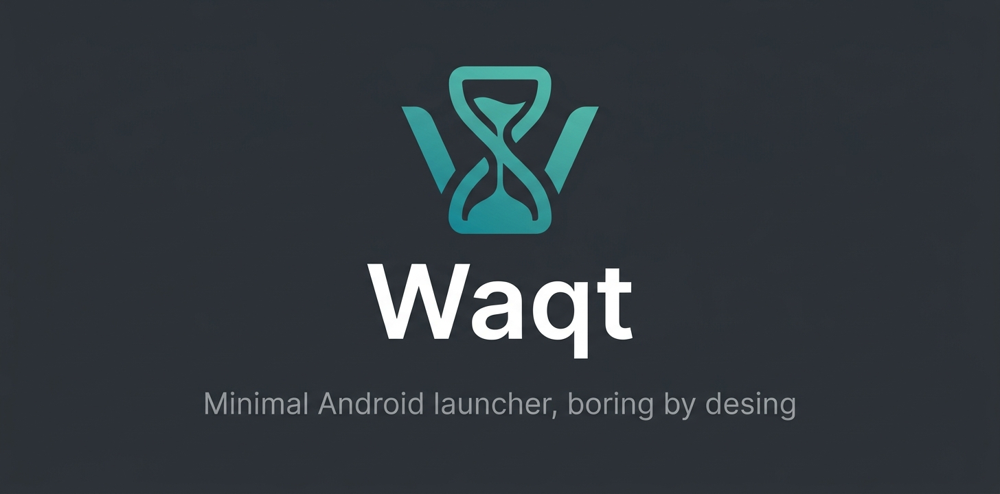

The goal is to create a home launcher that makes your favorite apps easy to access while making other apps tedious to access.
This app is inspired by [Escape-Launcher](Escape-Launcher), where I ran into a few issues.
If you prefer native you can check that too.

## Features

Fewer tweaks to keep things boring, so you spend less time on your phone

- Customize themes
- Favorite apps
- Quick search
- Footer note
- Double-tap to lock
- App visibility based on schedule **WIP**

## Why I made it

- To use it myself.
- To conduct a phone usage experiment among a group of users (December 2026).
- To help people who use their phones as tools, rather than letting their phones use them.
- To experiment with Method Channels.

## For whom

A few principles I follow when using my phone:

1. I don't like ads or any notifications. If I need to check something, I'll open the app myself.
2. No doomscrolling Social media apps should not be installed on my phone.
3. Yes, I do use YouTube in the browser, but you can always unhook yourself from Shorts. Search for what you need and clear the website data.
4. Whatever distracts me, just kill it. If you think something is important, write it down in your To-Do list.

## What you won't have

- App icons
- Wallpapers
- App time countdown or time tracker

Visit the [Release Cycle](Roadmap).

## Download

[From the release page](ReleasePage)

If you need modifications for your experiment, feel free to contact me on [LinkedIn][LinkedIn] or via email.

Support on ? `experimenting`

## License

Copyright © 2026 Md. Yeasin Sheikh.

This project is licensed under the [GNU Affero General Public License v3.0 (AGPL-3.0)](LICENSE). Anyone who modifies or distributes this app must also make their source code available under the same license.

[Escape-Launcher]: https://github.com/GeorgeClensy/Escape-Launcher
[ReleasePage]: https://github.com/yeasin50/waqt/releases/
[Roadmap]: https://github.com/users/yeasin50/projects/22/views/6
[LinkedIn]: https://www.linkedin.com/in/mdyeasinsheikh/
